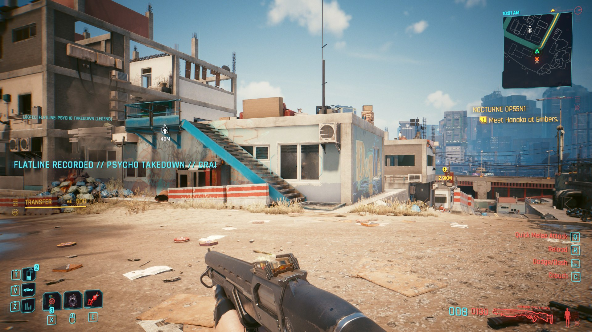
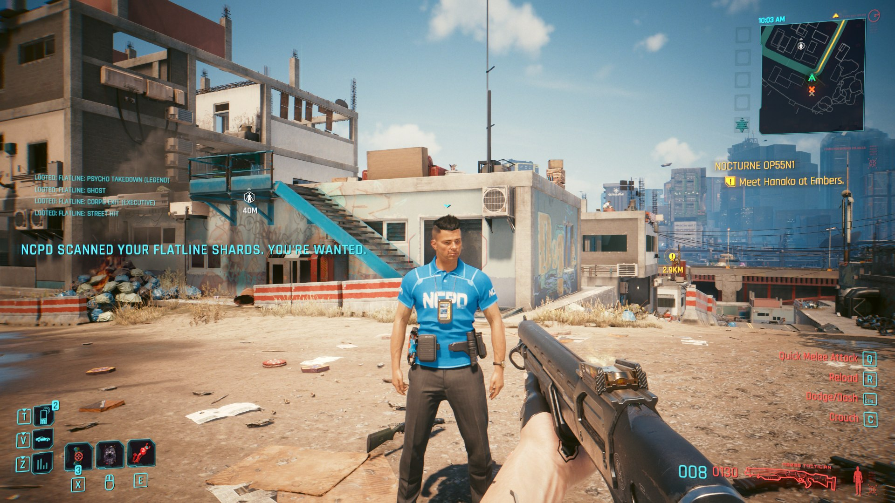
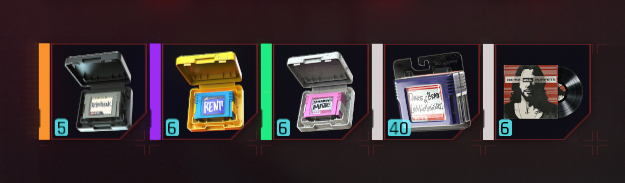

# Flatline Broker

Black-market braindances for Cyberpunk 2077.

**Download:** [Nexus Mods](https://www.nexusmods.com/cyberpunk2077/mods/36805)

In the lore, *flatlines* are braindances that record someone's death, and they
sell under the counter all over Night City. The base game never lets you join
that trade. Flatline Broker does.

Install a **Zetatech BD Scroller** in your frontal cortex and every human you
kill is cut to a flatline shard. What a shard is worth depends on how the kill
went down. Only shady BD dealers will buy them, and NCPD takes a dim view of
anyone carrying them.







## Features

**BD Scroller cyberware.** A frontal-cortex implant (humanity cost 4) stocked by
ripperdocs in Watson, Westbrook, Heywood, Pacifica, Santo Domingo and Dogtown.
While it is installed, your kills are recorded.

**Five kinds of flatline, three grades each.** The kind comes from how the kill
happened. When more than one applies, the most valuable kind wins.

| Kind | How you get it | Grade 1 | Grade 2 | Grade 3 |
|---|---|---|---|---|
| Street Hit | any kill that fits no other kind | €$150 | €$375 | €$900 |
| Ghost | you were out of combat, or a stealth hit | €$300 | €$750 | €$1,800 |
| Snuff Reel | headshot, finisher, dismemberment or explosion | €$350 | €$875 | €$2,100 |
| Corpo Exit | the victim works for a megacorp | €$600 | €$1,500 | €$3,600 |
| Psycho Takedown | the victim was a cyberpsycho | €$1,500 | €$3,750 | €$9,000 |

The grade comes from who the victim was: grade 1 for regular mooks, grade 2 for
officers, elites and rares, grade 3 for bosses and MaxTac.

Only humans are recorded. Drones, mechs, androids, civilians and crowd NPCs are
not.

**BD dealers only.** Flatlines sell only to netrunners and fences in Kabuki,
Jig-Jig Street, Japantown, Little China, Heywood and Dogtown. Every other vendor
refuses them. They are never swept up by the *sell all junk* or *disassemble
junk* buttons.

**NCPD heat.**
- *Patrol scan:* while you carry flatlines and are not wanted, an officer
  within 10 m may scan you every 15 seconds. The chance grows with the number
  of shards you carry (5% plus 3% per shard, up to 35%). A bust gives you one
  star. After a bust, patrols leave you alone for 3 minutes.
- *Manifest:* if you become wanted for anything else while carrying flatlines,
  NCPD pulls your shard manifest and adds one more star.

Neither rule fires during quest scenes or where police are locked out.

## Requirements

- Cyberpunk 2077, tested on 2.5 with Phantom Liberty
- [redscript](https://www.nexusmods.com/cyberpunk2077/mods/1511)
- [RED4ext](https://www.nexusmods.com/cyberpunk2077/mods/2380)
- [TweakXL](https://www.nexusmods.com/cyberpunk2077/mods/4197)
- [Codeware](https://www.nexusmods.com/cyberpunk2077/mods/7780)

## Installation

Extract the archive into your Cyberpunk 2077 folder, the one containing `bin`
and `r6`. Mod managers (Vortex, MO2) handle it as-is.

```
r6/scripts/FlatlineBroker/*.reds
r6/tweaks/FlatlineBroker/*.yaml
```

To uninstall, unequip the BD Scroller and sell or drop your flatlines first,
then delete those two folders.

To grab the implant right away for testing (needs Cyber Engine Tweaks):

```lua
Game.AddToInventory("Items.FlatlineBroker_BDScroller", 1)
```

## Compatibility

The mod adds records and wraps a handful of methods with `@wrapMethod`. It
replaces nothing, so it coexists with most mods:

- `NPCPuppet.OnDeath`: kill recording
- `PreventionSystem.OnHeatChanged`: the manifest rule
- `Vendor.PlayerCanSell`, `VendorDataManager.GetItemsPlayerCanSellFast`,
  `FullscreenVendorGameController.GetSellableJunk`, `UIInventoryItem.IsJunk`:
  the dealer and junk rules
- `PlayerPuppet.OnGameAttached`: starts the patrol timer

## Building from source

`src/` mirrors the game folder. `build.ps1` packs it into `dist/` for release.
`tools/` holds the in-game test harness used during development (a CET mod
that auto-loads a save, spawns NPCs, kills them and checks the results).
It is not part of the release.

## License

MIT, see [LICENSE](LICENSE).
